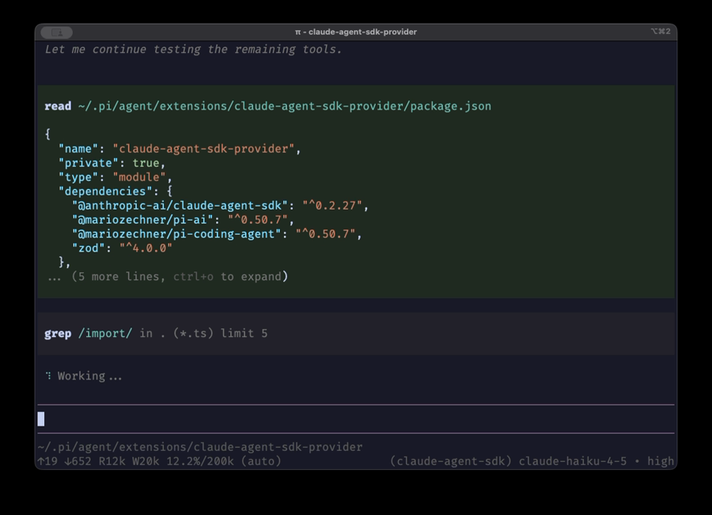

# claude-agent-sdk-pi

This extension registers a custom provider that routes LLM calls through the **Claude Agent SDK** while **pi executes tools** and renders tool results in the TUI.

## Highlights

- Claude Agent SDK is used as the LLM backend (Claude Code auth or API key).
- Tool execution is **blocked in Claude Code**; pi executes tools natively.
- Built-in tool calls are mapped to Claude Code tool names.
- Custom tools are exposed to Claude Code via in-process MCP.
- Pi’s complete effective system prompt reaches the SDK unchanged, including parent context, role instructions, project instructions, and skills.

## Demo



## Setup

1) Install the extension globally (npm is the preferred source now):

```
pi install npm:claude-agent-sdk-pi
```

(You can pin a specific version for reproducible installs.)

**Alternative (git):**

```
pi install git:github.com/prateekmedia/claude-agent-sdk-pi
```

See **pi-coding-agent** install docs for other install sources and paths.

2) **Authenticate** (choose one):

- **Claude Code login** (Pro/Max):
  ```bash
  npx @anthropic-ai/claude-code
  ```
  Ensure no API key env vars are set.

- **API key** (API plan):
  ```bash
  export ANTHROPIC_API_KEY=sk-ant-...
  ```

3) Reload pi:

```
/reload
```

## Provider ID

`claude-agent-sdk`

Use `/model` to select:
- `claude-agent-sdk/claude-opus-4-5`
- `claude-agent-sdk/claude-haiku-4-5`

## Tool Behavior

- Claude Code **proposes** tool calls.
- pi **executes** them.
- Tool execution in Claude Code is **denied**.

Built-in tool mapping (Claude Code → pi):

- Read → read
- Write → write
- Edit → edit
- Bash → bash
- Grep → grep
- Glob → find

Claude Code only sees the tools that are active in pi.

### Custom tools

Any extra tools registered in pi are exposed to Claude Code via an in-process MCP server:

- MCP server name: `custom-tools`
- Claude Code tool name format: `mcp__custom-tools__<toolName>`
- Example: `mcp__custom-tools__subagent`

The provider automatically maps these back to the pi tool name (e.g. `subagent`).

## Context loading

The provider always transmits Pi’s effective system prompt verbatim: `context.systemPrompt` under Pi 0.74, or, because Pi 1.x passes providers only a `{ messages }` transcript, the prompt and tool list rebuilt from its system messages with Pi’s own `getCurrentSystemPrompt` and `getCurrentTools`. Pi owns instruction assembly. The provider does not reread `AGENTS.md`, extract selected skills, rename tools in instructions, or rewrite instruction text or paths. Built-in tool-name and argument-key mapping described above remains unchanged; tool paths are no longer rewritten to compensate for rewritten skill instructions.

- **Default (`appendSystemPrompt: true`):** append the complete Pi prompt once to the SDK’s `claude_code` preset.
- **Changed behavior (`appendSystemPrompt: false`):** use the complete Pi prompt as the SDK’s replacement system prompt, without the Claude Code preset. This setting no longer suppresses Pi instructions. Existing users who relied on Claude-only instructions must migrate; there is no silent instruction opt-out. If you followed the previous symlink setup, remove the `~/.claude/CLAUDE.md` and `~/.claude/skills` links to Pi resources when they duplicate Pi’s prompt; remove only the symlinks, not their targets.
- `settingSources` still selects Claude Code filesystem settings. With `appendSystemPrompt: false`, its default remains `["user", "project"]`. Explicitly selected Claude resources are additional to Pi’s prompt; avoid linking the same instructions into both systems.
- `strictMcpConfig` still defaults to `false` in append mode and `true` in replacement mode. Enable it to prevent unrelated MCP servers from being auto-loaded. SDK-side execution remains denied in either mode.

For the Claude Code preset plus Pi’s complete prompt, without inherited settings or MCP servers:

```json
{
  "claudeAgentSdkProvider": {
    "appendSystemPrompt": true,
    "settingSources": [],
    "strictMcpConfig": true
  }
}
```

### Custom-tool schema compatibility

Pi supplies JSON Schema, while the Agent SDK’s high-level `tools[].inputSchema` interface expects a Zod raw shape. The provider uses the public low-level MCP request handlers on the SDK-created server instead: `tools/list` advertises Pi’s original JSON Schema without conversion, and `tools/call` returns the existing execution-denied error. This preserves required fields, nested objects, arrays, enums, references, records, and validation constraints without a lossy Zod round trip. Invalid MCP tool envelopes fail with the offending Pi tool’s name rather than falling back to an empty schema. Pi remains responsible for validating and executing actual calls.

### Compatibility checks

Development dependencies retain upstream’s Pi 0.74.x baseline; peer ranges also allow Pi 1.4 and later compatible 1.x releases. Pi 1.x’s extension loader supplies the legacy API compatibility view used by this extension. Run `npm ci --ignore-scripts` and `npm test` on Node 24. To repeat the same seam checks with another installed Pi version, set `PI_TEST_AGENT_ENTRY` to the file URL of that installation’s `dist/index.js`. The tests load the extension through Pi’s actual loader and run the official SDK against a disposable, credential-free transport fixture. Under Pi 1.x loaders each provider call receives a `{ messages }` transcript shaped like Pi’s own: the prompt in system-message `sections`, and tools as additions and removals. They check effective instruction transmission, actual MCP discovery, Pi-side tool argument/result delivery, SDK execution denial, streaming, adaptive thinking, invalid contracts, and cancellation. They do not contact Claude or prove live subscription access.
